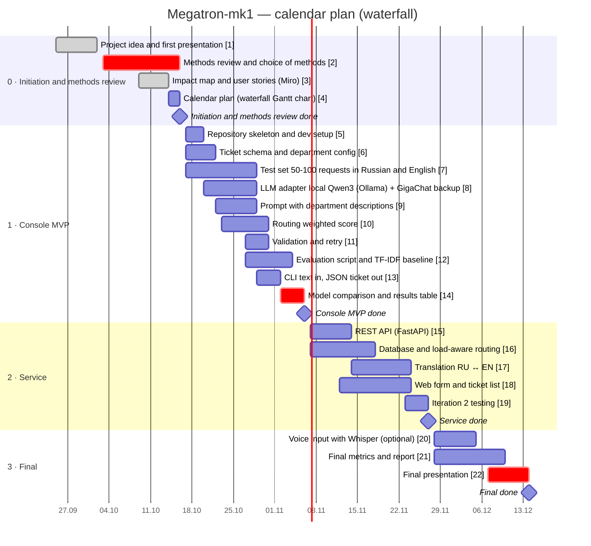

# Megatron-mk1 — intelligent technical support system

Megatron-mk1 turns a user's free-text request into a structured support ticket and assigns it to the most suitable and least busy support department.

- **Input:** a request in Russian or English (text; voice later).
- **Output:** a JSON ticket — who, where, when, what, summary, tags, department — always valid against the ticket schema.
- **How:** an LLM with schema-constrained output (local Qwen3-8B via Ollama; GigaChat API as backup) + a weighted routing score (profile match and current load).

**Team (group 2, SPbPU, Higher School of Cyber-Physical Systems Control):** Daniil Pliukhin, Roman Grin, Denis Gorshkov.

## Calendar plan

Waterfall plan by stage. Critical points are highlighted. Tasks are tracked as [issues](https://github.com/Leenday/support_megatron_mk1/issues), stages as [milestones](https://github.com/Leenday/support_megatron_mk1/milestones).

| Issue | Task | Start | Due | Owner | Done |
|---|---|---|---|---|---|
| [#1](https://github.com/Leenday/support_megatron_mk1/issues/1) | Project idea and first presentation | 2026-09-25 | 2026-10-02 | All | ✅ |
| [#2](https://github.com/Leenday/support_megatron_mk1/issues/2) | Methods review and choice of methods | 2026-10-03 | 2026-10-16 | Denis |  |
| [#3](https://github.com/Leenday/support_megatron_mk1/issues/3) | Impact map and user stories (Miro) | 2026-10-09 | 2026-10-14 | Denis | ✅ |
| [#4](https://github.com/Leenday/support_megatron_mk1/issues/4) | Calendar plan (waterfall Gantt chart) | 2026-10-14 | 2026-10-16 | Denis |  |
| [#5](https://github.com/Leenday/support_megatron_mk1/issues/5) | Repository skeleton and dev setup | 2026-10-17 | 2026-10-20 | Denis |  |
| [#6](https://github.com/Leenday/support_megatron_mk1/issues/6) | Ticket schema and department config | 2026-10-17 | 2026-10-22 | Roman |  |
| [#7](https://github.com/Leenday/support_megatron_mk1/issues/7) | Test set: 50-100 requests in Russian and English | 2026-10-17 | 2026-10-29 | Daniil |  |
| [#8](https://github.com/Leenday/support_megatron_mk1/issues/8) | LLM adapter: local Qwen3 (Ollama) + GigaChat backup | 2026-10-20 | 2026-10-29 | Denis |  |
| [#9](https://github.com/Leenday/support_megatron_mk1/issues/9) | Prompt with department descriptions | 2026-10-22 | 2026-10-29 | Denis |  |
| [#10](https://github.com/Leenday/support_megatron_mk1/issues/10) | Routing: weighted score | 2026-10-23 | 2026-10-31 | Roman |  |
| [#11](https://github.com/Leenday/support_megatron_mk1/issues/11) | Validation and retry | 2026-10-27 | 2026-10-31 | Roman |  |
| [#12](https://github.com/Leenday/support_megatron_mk1/issues/12) | Evaluation script and TF-IDF baseline | 2026-10-27 | 2026-11-04 | Daniil |  |
| [#13](https://github.com/Leenday/support_megatron_mk1/issues/13) | CLI: text in, JSON ticket out | 2026-10-29 | 2026-11-02 | Denis |  |
| [#14](https://github.com/Leenday/support_megatron_mk1/issues/14) | Model comparison and results table | 2026-11-02 | 2026-11-06 | Denis |  |
| [#15](https://github.com/Leenday/support_megatron_mk1/issues/15) | REST API (FastAPI) | 2026-11-07 | 2026-11-14 | Denis |  |
| [#16](https://github.com/Leenday/support_megatron_mk1/issues/16) | Database and load-aware routing | 2026-11-07 | 2026-11-18 | Roman |  |
| [#17](https://github.com/Leenday/support_megatron_mk1/issues/17) | Translation RU <-> EN | 2026-11-14 | 2026-11-24 | Denis |  |
| [#18](https://github.com/Leenday/support_megatron_mk1/issues/18) | Web form and ticket list | 2026-11-12 | 2026-11-24 | Daniil |  |
| [#19](https://github.com/Leenday/support_megatron_mk1/issues/19) | Iteration 2 testing | 2026-11-23 | 2026-11-27 | All |  |
| [#20](https://github.com/Leenday/support_megatron_mk1/issues/20) | Voice input with Whisper (optional) | 2026-11-28 | 2026-12-05 | Denis |  |
| [#21](https://github.com/Leenday/support_megatron_mk1/issues/21) | Final metrics and report | 2026-11-28 | 2026-12-10 | All |  |
| [#22](https://github.com/Leenday/support_megatron_mk1/issues/22) | Final presentation | 2026-12-07 | 2026-12-14 | All |  |

## Stages

| Stage | Due | Result |
|---|---|---|
| 0 · Initiation and methods review | 2026-10-16 | Idea, first presentation, methods review, impact map, calendar plan. |
| 1 · Console MVP | 2026-11-06 | Iteration 1: console app, text in -> JSON ticket out; test set and model comparison. |
| 2 · Service | 2026-11-27 | Iteration 2: REST API, database, load-aware routing, web form and ticket list, RU/EN translation. |
| 3 · Final | 2026-12-14 | Optional voice input, final metrics, report and final presentation. The programme ends in mid-December; exact date to be confirmed. |

*Dates after 2026-10-16 are planned and may shift; the final date depends on the programme schedule (mid-December).*
